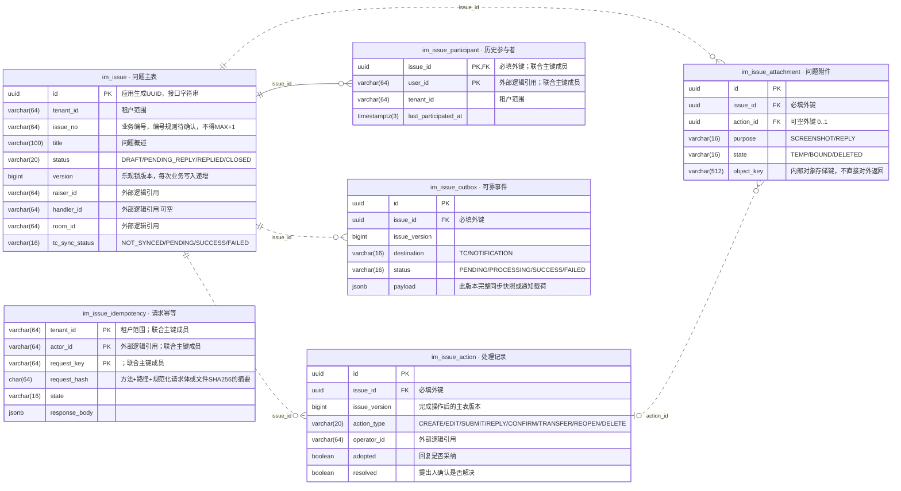
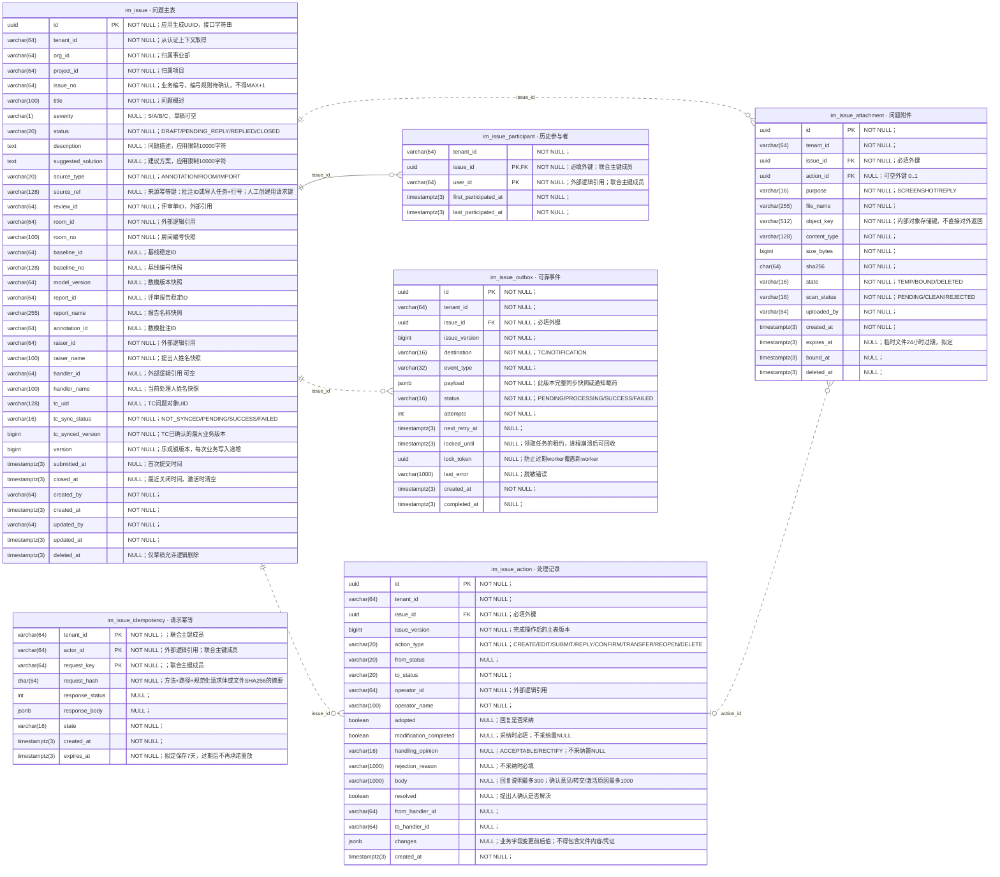

# 问题管理 PostgreSQL ER图

依据当前 ddl.sql（v0.2），2026-11-07。共6张表、101个字段、5条物理外键；总览省略部分字段，完整字段图保留全部列。

[PNG总览](ER图_总览.png) · [SVG矢量图](ER图_总览.svg) · [总览Mermaid源文件](ER图_总览.mmd) · [完整字段Mermaid源文件](ER图_完整字段.mmd)

## 总览

## 图例与关联含义

- `PK`为主键成员；`FK`为数据库已声明的物理外键。复合主键中的每个成员均标PK，不表示单列唯一。
- `||`为恰好一个，`o{`为零到多；附件指向处理记录一端的`|o`表示零或一个。
- 实线表示父键也是子表主键的一部分；虚线表示非标识关系。两种连线都可能是数据库物理外键，不能把虚线误读成外部引用。
- 每个问题可以有多条处理记录、历史参与者、附件和可靠事件。附件必须归属一个问题，但可不关联具体处理记录（截图、临时上传等）。
- 请求幂等表没有issue_id或问题外键，独立按租户、操作者、请求键去重；因此图中不连到问题表。

|父表|子表及外键|基数|说明|
|---|---|---|---|
|im_issue|im_issue_action.issue_id|1 → 0..N|每条操作记录必须对应一个问题|
|im_issue|im_issue_participant.issue_id|1 → 0..N|每条参与关系必须对应一个问题|
|im_issue|im_issue_attachment.issue_id|1 → 0..N|每个附件必须对应一个问题|
|im_issue_action|im_issue_attachment.action_id|0..1 ← 0..N|单个附件最多关联一条操作；单条操作可有多个附件|
|im_issue|im_issue_outbox.issue_id|1 → 0..N|每个事件必须对应一个问题|

图中的0..N依据数据库约束：外键不强制父记录至少有一条子记录。业务创建事务会同时写CREATE历史和参与者，这是应用规则。

## 唯一约束

|表|约束|联合唯一字段|
|---|---|---|
|im_issue|uk_issue_no|tenant_id, issue_no|
|im_issue|uk_issue_source|tenant_id, source_type, source_ref|
|im_issue|uk_issue_tc|tenant_id, tc_uid|
|im_issue_action|uk_action_version|issue_id, issue_version|
|im_issue_outbox|uk_outbox_version|issue_id, issue_version, destination|

可空唯一键成员遵循PostgreSQL默认语义：多条NULL不互相冲突。上述唯一约束均不能把某个成员单独视为唯一。

## 外部逻辑引用与实现约束

|字段范围|引用对象|数据库外键|
|---|---|---|
|tenant_id / org_id / project_id|租户、事业部、项目主数据|无，应用校验|
|raiser_id / handler_id / user_id / operator_id / actor_id / uploaded_by等人员字段|统一用户服务|无，应用校验|
|review_id / room_id|评审单、评审房间|无，应用校验|
|baseline_id / report_id / annotation_id|数模基线、评审报告、批注|无，应用校验|
|tc_uid|TC问题对象|无，集成服务维护|
|object_key|对象存储中的文件|无，文件服务维护|

以上均是逻辑引用，当前DDL未定义外部实体表，因此不绘制成已建物理表。
子表tenant_id与主表一致性，以及附件action_id对应操作与附件issue_id归属同一问题，由应用事务校验；当前DDL的单列外键没有强制这两项跨字段一致性。
outbox.issue_version是业务事件版本；它与处理记录的版本保持应用层一致，当前DDL没有声明指向action的复合外键。

## 完整字段图

完整图适合放大查看；精确约束表达式、索引、默认值见ddl.sql。重新生成Mermaid/SVG：`python generate_er.py`；Windows下重新生成PNG：`./render_er.ps1`。
